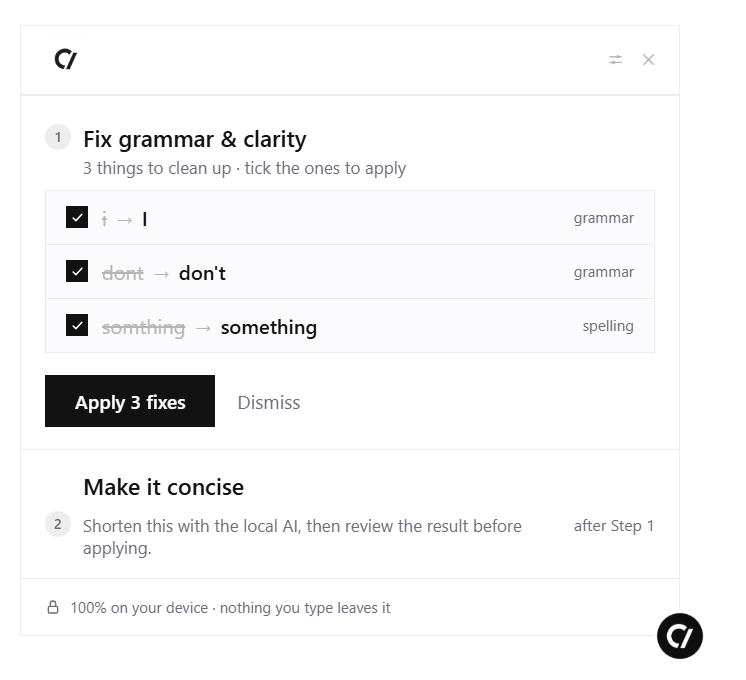

# Comprsly

Comprsly fixes your spelling and grammar as you type in AI chats, then optionally shortens the whole prompt using a small AI model that runs entirely on your own PC. Nothing you type leaves your computer.

[comprsly.com](https://comprsly.com) · [Get it free on the Microsoft Store](https://apps.microsoft.com/detail/9N8W5HPJ4DHV)



**Windows 10 and 11.** Version 1.1.1, the same version that is in the Store. A macOS version is built and in testing: there is no Mac download and no date. There is no Linux version.

## What it does

A small round badge appears in the box you are already typing in. Click it and you get two steps.

1. **Spelling and grammar.** Each fix is listed with the old text struck through and the correction beside it. Confident ones are ticked, less certain ones are left for you to check. Nothing changes until you click Apply.
2. **Make it concise.** Optional, and runs the local model. Your prompt and the shorter version sit side by side with the tokens saved, and again nothing changes until you click.

**Where it appears:** Claude (including Claude Code), ChatGPT, Gemini (including the Chrome side panel), Perplexity, Copilot, Grok and DeepSeek, plus Le Chat, Poe, Hugging Face, You.com, Pi and Character.AI.

**In a terminal:** Windows Terminal, PowerShell, Command Prompt, Git Bash, WSL, and the integrated terminal in VS Code, Cursor and Windsurf. It only wakes up when an AI CLI is actually running there, so an ordinary prompt is left alone. The CLIs it recognises are Claude Code, Codex CLI, Copilot CLI and Gemini CLI.

Everywhere else it stays out of the way, by design.

## Install

Open the [Microsoft Store listing](https://apps.microsoft.com/detail/9N8W5HPJ4DHV) and click Get. Launch Comprsly once and a short setup screen walks you through it. After that it runs in the background and appears when you type in a supported app. It is free and there is no account.

## Privacy

Spelling and grammar run on your PC with a rules engine: no model, no network. The shortening step uses a small open model running locally on your CPU. There is no account, no sign in and no telemetry. Settings, history and logs live in `%LOCALAPPDATA%\Comprsly`, on your machine only.

Full policy: [comprsly.com/privacy](https://comprsly.com/privacy/)

## Build it yourself

```
pip install -r product/build/requirements.txt
python product/backend/main.py
```

The tests:

```
python -m unittest discover -s product/backend -p "test_*.py"
```

More detail, including how to package the installer, is in [CONTRIBUTING.md](CONTRIBUTING.md).

## Help

**The badge does not appear.** Check that **AI chat apps** is on in Settings, General, and that you are in one of the apps listed above. The badge only shows once there is text in the box, and in a terminal only when an AI CLI is running.

**Step 2 is unavailable.** The model is not on your device. Open Settings, AI and download it, about 1 GB.

**Something else.** `%LOCALAPPDATA%\Comprsly\debug.log` records what Comprsly is doing and is the fastest way to see what went wrong.

Questions: [contact@comprsly.com](mailto:contact@comprsly.com)

## License

MIT, see [product/LICENSE](product/LICENSE).
